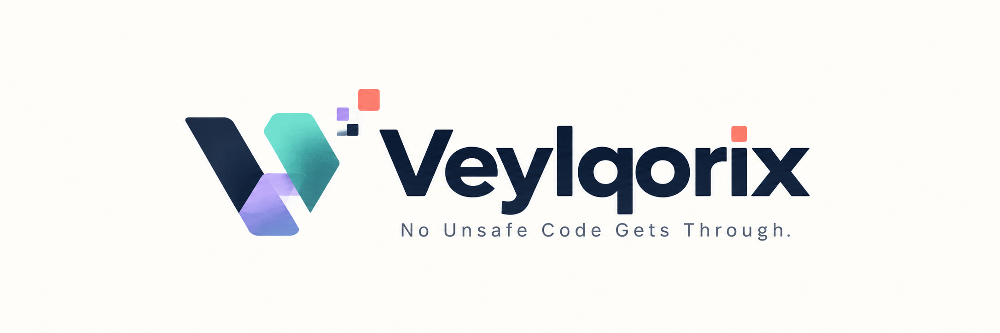
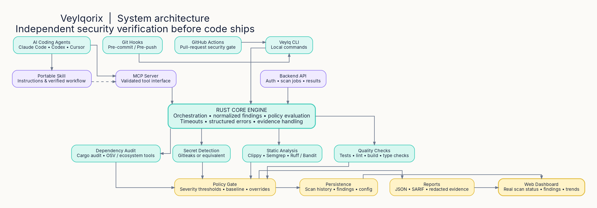
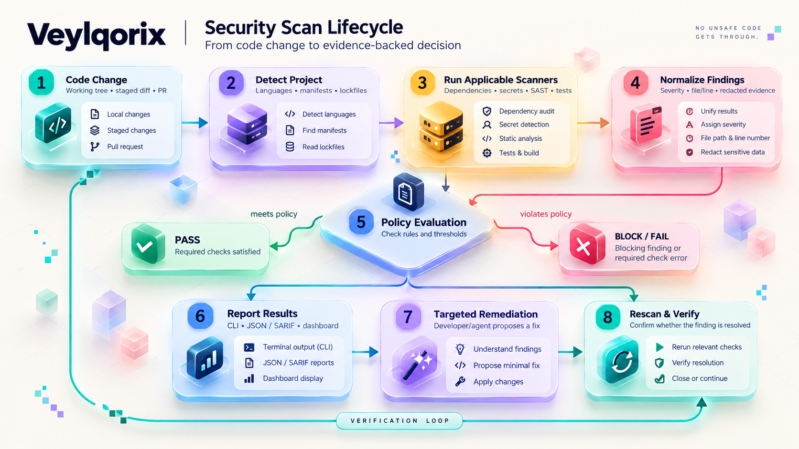
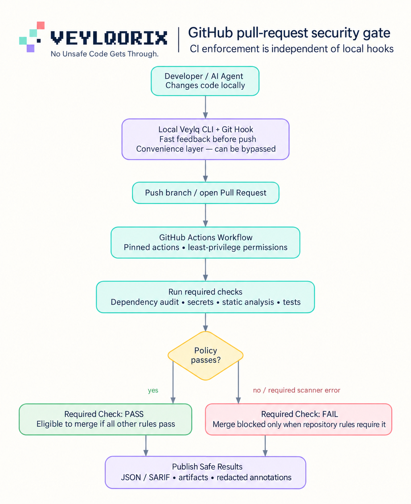
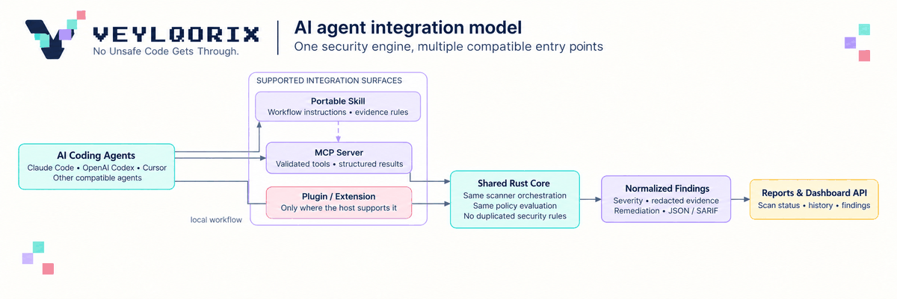
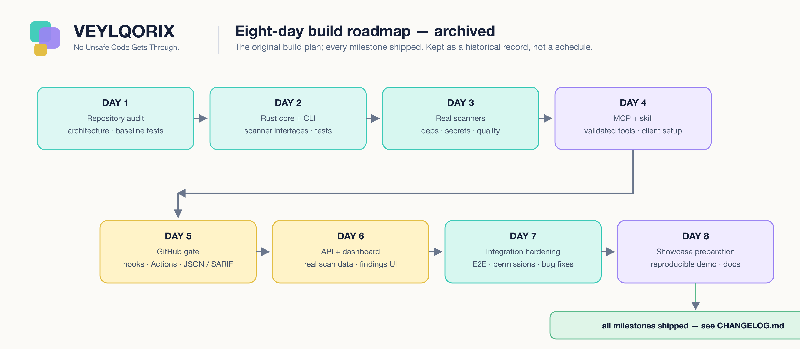

<p align="center">
  
</p>

<h1 align="center">Veylqorix</h1>

<p align="center"><strong>No Unsafe Code Gets Through.</strong></p>

<p align="center">
  <a href="https://github.com/soumyachk101/Veylqorix/actions/workflows/ci.yml"></a>
  <a href="LICENSE"></a>
  <a href="https://nodejs.org">= 20.18"></a>
  <a href="crates/"></a>
  <a href="packages/mcp-server/"></a>
</p>

<p align="center">
  A code-security and quality gate platform: TypeScript/pnpm monorepo plus a standalone
  Rust security engine. It orchestrates <em>real</em> scanners — dependency auditing,
  secret detection, license checks, static analysis, and test suites — normalizes
  their output into one finding schema, and turns it into a deterministic gate
  decision with auditable evidence. A scanner error or a skipped mandatory check
  degrades coverage and is <strong>never</strong> mistaken for a clean pass.
</p>

> **Scope.** Veylqorix reports what its scanners found. It does not certify the
> absence of vulnerabilities or secrets.

---

## Contents

- [Why Veylqorix](#why-veylqorix)
- [How it works](#how-it-works)
- [Quick start](#quick-start)
- [Surfaces at a glance](#surfaces-at-a-glance)
- [CLI](#cli)
- [MCP server](#mcp-server)
- [REST API and dashboard](#rest-api-and-dashboard)
- [GitHub Actions gate](#github-actions-gate)
- [Agent skills](#agent-skills)
- [Programmatic API](#programmatic-api)
- [Rust security engine](#rust-security-engine)
- [Policy and exceptions](#policy-and-exceptions)
- [Security properties](#security-properties)
- [Honest limitations](#honest-limitations)
- [Roadmap](#roadmap)
- [Development](#development)
- [Repository layout](#repository-layout)
- [Documentation](#documentation)
- [Community](#community)
- [License](#license)

---

## Why Veylqorix

AI coding agents now write a large share of production code — fast, plausible,
and occasionally unsafe. Lint and CI pipelines were not designed to verify that
volume. Veylqorix fills the gap with four guarantees:

1. **Real evidence, no fabrication.** Every finding, severity, and exit code
   comes from an actual scanner run. A check that cannot run is reported
   `SKIPPED` or `ERROR` with a reason — never a clean pass.
2. **One core, many surfaces.** CLI, MCP, API/dashboard, GitHub Actions, and
   agent skills are thin adapters over a single shared security engine, so
   security logic lives in one place and behaves identically everywhere.
   The Rust engine (`crates/veylqorix-engine`) is the authoritative secret
   scanner, policy engine, and gate; the TypeScript core calls it through a
   stdio adapter and degrades to a byte-compatible TypeScript fallback only
   when the binary is unavailable (labeled, never silent). See
   [Rust security engine](#rust-security-engine).
3. **Deterministic gate.** Exit codes are stable — `0` PASS · `1` FAIL · `2`
   INCOMPLETE — on every surface, so CI branching is predictable and
   auditable.
4. **Agent-safe policy.** An AI agent cannot suppress findings or raise
   thresholds: exceptions must be documented, capped, and expirable, and are
   visible in the committed policy file and in every gate decision.

## How it works

The architecture separates four layers:

- **Entry points** — who runs a scan: the `veylqorix` CLI, the `veylqorix-mcp`
  server, the REST API, a reusable GitHub Actions gate, and portable agent
  skills.
- **Integration layer** — each surface is a thin adapter with no security
  logic of its own; they all call the same core.
- **Core engine** (`packages/core`) — project detection, scanner adapters,
  path confinement, finding normalization, policy evaluation, the gate, and
  report rendering (JSON, Markdown, SARIF).
- **Results and enforcement surfaces** — gate chips and findings in the
  dashboard, SARIF uploads to GitHub code scanning, exit codes for CI
  branching.

A second, standalone engine — the **Rust security engine**
(`crates/veylqorix-engine`) — implements the same gate semantics as a
JSON-over-stdio subprocess, byte-compatible with the TypeScript core. It is
covered in depth in [Rust security engine](#rust-security-engine).



*System architecture — diagram palette and re-render notes in
[Veylqorix_Diagrams/README.md](Veylqorix_Diagrams/README.md). The editable
`.dot` source for this diagram is not yet committed (rendered PNGs only).*

Scanner adapters **reuse existing tools rather than reimplementing them**:

| Scanner      | Backed by                                                         | Offline? |
|--------------|-------------------------------------------------------------------|----------|
| dependencies | `npm audit` (Node) / `pip-audit` (Python); `cargo audit` in the Rust engine | optional |
| secrets      | built-in rule set (9 named rules, values redacted); Gitleaks delegation in the Rust engine when the binary is on PATH | yes |
| licenses     | manifest license checks                                           | yes      |
| quality      | `tsc`, `eslint`, `ruff`, project test scripts                    | no       |

> `--scanners` accepts the three registry IDs `dependencies`, `secrets`,
> and `licenses`. The `quality` row above is the check suite (typecheck,
> lint, tests), not a scanner ID — it is toggled with `--no-tests`, and
> passing `quality` to `--scanners` selects no scanners.

Every scan follows the same evidence-based loop:



*Scan lifecycle — [Veylqorix_Diagrams/README.md](Veylqorix_Diagrams/README.md).*

- **Normalize before judging.** All scanner output is converted to one
  finding schema (severity, file/line, redacted evidence, remediation)
  before the policy gate evaluates it.
- **Gate failures are first-class.** A scanner that cannot run routes the
  decision to `INCOMPLETE` (exit 2), never to a pass.
- **Verify, don't trust.** After a fix, the scan re-runs to confirm the
  finding no longer reproduces — the remediation loop is part of the
  protocol, not a suggestion.

## Quick start

Prerequisites: **Node 20.18+**, **pnpm 9+**, and a stable Rust toolchain
(to build the engine).

```sh
pnpm install
pnpm build        # build all packages
pnpm test         # vitest unit + integration suite
```

### Scan a repository from the CLI

The CLI is packaged and dry-run-validated (`pnpm pack --dry-run`) but not
published to npm yet — run it from the build output until publish:

```sh
node apps/cli/dist/index.js scan --root /path/to/repo --json
```

Exit codes: `0` PASS · `1` FAIL (blocking findings) · `2` INCOMPLETE
(coverage degraded) · `64` usage error · `65` bad root · `70` unexpected
error.

### Run the API and dashboard

```sh
pnpm --filter @veylqorix/api start   # API on http://localhost:4173
pnpm --filter @veylqorix/web dev     # Next.js dashboard on http://localhost:3000
```

Open <http://localhost:3000/dashboard> — full instructions in
[docs/dashboard.md](docs/dashboard.md). The dashboard proxies `/api/*` to
the API via Next.js rewrites (`NEXT_PUBLIC_API_BASE`, default
`http://localhost:4173` — set it for cross-origin deployments). When the
API is unreachable, the dashboard shows a live-status banner and offers
clearly labeled sample data (**SAMPLE DATA** badge, never presented as
live).

### Build and test the Rust engine

All cargo commands target the workspace manifest at `crates/Cargo.toml`
(there is no `Cargo.toml` at the repo root):

```sh
cargo build --release --manifest-path crates/Cargo.toml --workspace
cargo test --manifest-path crates/Cargo.toml --workspace --all-features
```

Verify the binary:

```sh
crates/target/release/veylqorix-engine --version
# veylqorix-engine 0.1.0 (protocol 1, schema 1)

# requests are one JSON document on stdin, one JSON document on stdout
echo '{"protocolVersion":1,"command":"ping","args":{}}' \
  | crates/target/release/veylqorix-engine
```

## Surfaces at a glance

| Surface                       | Where                                    | Status (verified)                                                                                                             | Docs |
|-------------------------------|------------------------------------------|-------------------------------------------------------------------------------------------------------------------------------|------|
| CLI (`veylqorix`)             | `apps/cli`                               | Real scans, deterministic exit codes, safe dry-run hook installer. **Packaged and dry-run-validated; not published to npm — run from `dist/` until publish.** | [docs/cli.md](docs/cli.md) |
| MCP server (`veylqorix-mcp`)  | `packages/mcp-server`                    | Six Zod-validated tools, root confinement + redaction. Requires `pnpm build`.                                                 | [docs/mcp.md](docs/mcp.md) |
| REST API + dashboard          | `packages/api`, `apps/web`               | Dependency-free API on `:4173`; Next.js dashboard on `:3000` with a clearly-labeled **SAMPLE DATA** fallback when the API is down. | [docs/api.md](docs/api.md) · [docs/dashboard.md](docs/dashboard.md) |
| GitHub Actions gate           | `.github/workflows/veylqorix-gate.yml`   | Reusable `workflow_call` gate: real scan + SARIF upload, SHA-pinned actions, least-privilege permissions. **Advisory until a branch-protection rule requires the check.** | [docs/github-actions.md](docs/github-actions.md) |
| Agent skills                  | `packages/skills`                        | Portable `SKILL.md` + ready-made MCP configs for Claude Code, Codex, and Cursor.                                              | [packages/skills](packages/skills) |
| Rust security engine          | `crates/veylqorix-engine`                | Binary + JSON-stdio protocol + 60 tests; called by the TypeScript core through the engine adapter. | below |

**Honest note:** the gate and the CLI hooks are *advisory* until
enforcement (branch protection) is in place; the CLI is packaged and
dry-run-validated but not published to npm yet. See
[Honest limitations](#honest-limitations) and
[docs/faq.md](docs/faq.md).

## CLI

`@veylqorix/cli` (v0.1.0, MIT, ESM) exposes the `veylqorix` binary — a thin
adapter over the core engine. Every result comes from a real scanner run.

| Command                        | What it does                                   |
|--------------------------------|------------------------------------------------|
| `scan [root]`                  | Full audit + quality gate (default command)   |
| `check [root]`                 | Quality checks only (typecheck, lint, tests); no scanners run, so the gate always reports `INCOMPLETE` (exit 2) — run `scan` for a full audit |
| `report [root]`                | Human-readable Markdown report                 |
| `config validate FILE`         | Validate a policy JSON file                    |
| `hooks install \| uninstall`   | Safe Git hook installer (dry-run by default)   |

Options (`--format` accepts only `json | markdown | sarif`):

| Option                       | What it does                                             |
|------------------------------|----------------------------------------------------------|
| `--root PATH`                | repository to scan                                       |
| `--staged`                   | scope the secret scan to Git-staged files                |
| `--json` / `--format json\|markdown\|sarif` | machine-readable or SARIF output             |
| `--report-out FILE`          | write a Markdown report                                  |
| `--sarif-out FILE`           | write a SARIF report                                     |
| `--offline`                  | skip network-dependent scanners                          |
| `--no-tests`                 | skip test/build checks                                   |
| `--scanners a,b`            | run only these scanners — IDs: `dependencies`, `secrets`, `licenses` |
| `--block-on a,b`             | severities that block the gate                           |
| `--policy FILE`              | load a policy JSON file                                  |
| `--pre-push`                 | also generate the pre-push hook (`hooks install`)         |
| `--force`, `-y` / `--yes`    | write hooks (dry-run is the default)                     |
| `-h`, `--help`               | usage                                                    |

`hooks install` prints the generated `.git/hooks/pre-commit` (and `pre-push`
with `--pre-push`) scripts by default — each with a `VEYLQORIX_OVERRIDE=1`
escape — and writes only with `--yes`, backing up existing hooks. Install
errors exit `64`. Legacy aliases (`audit`, `deps`, `secrets`, `gate`,
`checks`) normalize to `scan` / `check` — old scripts keep working.

| Exit | Meaning                                                        |
|------|----------------------------------------------------------------|
| `0`  | PASS — no blocking findings                                    |
| `1`  | FAIL — one or more blocking findings                           |
| `2`  | INCOMPLETE — coverage degraded; **never treated as a pass**    |
| `64` | usage error, invalid policy, or hooks install error            |
| `65` | root or policy file not found, or no staged files under `--staged` |
| `70` | unexpected error (catch-all)                                   |

Full reference: [docs/cli.md](docs/cli.md).

## MCP server

`@veylqorix/mcp-server` exposes the engine to AI coding agents (Claude
Code, Codex, Cursor, and any MCP client) as a stdio server — the
`veylqorix-mcp` binary at `packages/mcp-server/dist/bin.js`. Six tools,
exactly:

| Tool                  | Purpose                                                        |
|-----------------------|----------------------------------------------------------------|
| `scan_repository`     | full audit + gate over a confined root                          |
| `scan_dependencies`   | dependency audit (`npm audit` / `pip-audit` backends)          |
| `scan_secrets`        | secret-detection scan (values redacted)                         |
| `run_security_checks` | type, lint, and test checks                                     |
| `get_findings`        | fast findings listing without quality checks; optional `limit` (int 1–500, default 100) |
| `validate_fix`        | re-run the scan to confirm a proposed fix removes the finding  |

Tool parameters (`root` — a non-empty string resolved inside the configured
roots — is required on every tool; everything else is optional):

| Tool | Parameters |
|------|-----------|
| `scan_repository` | `onlyScanners` (`dependencies` / `secrets` / `licenses`) · `skipQualityChecks` (default `false`) · `includeTests` (default `true`) · `blockOnSeverity` (`INFO`…`CRITICAL`, default `CRITICAL` + `HIGH`) · `blockOnSecrets` (default `true`) |
| `scan_dependencies` | `root` only |
| `scan_secrets` | `root` only |
| `run_security_checks` | `root` · `includeTests` (default `true`) |
| `get_findings` | `root` · `onlyScanners` · `limit` (int 1–500, default 100) |
| `validate_fix` | `root` · `scanners` (named `scanners`, not `onlyScanners`) · `findingIds` (non-empty strings to verify as resolved) |

Security properties:

- **Input validation.** Zod schema per tool: `root` (non-empty string) on
  every tool, a scanner enum (`dependencies` / `secrets` / `licenses`),
  and a severity enum (`INFO`…`CRITICAL`) on `scan_repository.blockOnSeverity`
  (severity filtering is not a general tool parameter); malformed or missing
  args surface as `isError` results, not crashes.
- **Root confinement.** All filesystem access is confined to configured
  roots: `..` traversal, symlink escapes, and absolute paths outside the
  roots are rejected (`PATH_ERROR`) *before any filesystem access*.
- **Redaction, defense-in-depth.** A pattern set (AWS `AKIA…`, GitHub
  `ghp_/gho_/ghu_/ghs_/ghr_`, Slack `xox*`, Anthropic `sk-ant*`, generic
  `sk-`, Google `AIza*`, Stripe-like, emails, `PRIVATE KEY` blocks) is
  applied to text content and recursively over structured content;
  matched values are masked as `abcd…wxyz [redacted N chars]`.
- **Honest statuses.** A scanner that is unavailable (offline mode,
  missing binary) is reported `SKIPPED`/`ERROR` with `available: false`
  — never a pass. Gate results PASS/FAIL/INCOMPLETE map to exit codes
  `0`/`1`/`2` (findings caps: 200 per response for the scan tools,
  100 default / 500 max for `get_findings`; text truncated at 60 000
  chars).
- **No side-channel.** The agent cannot commit or push through the
  server.

Configuration is via environment in the server process: `VEYLQORIX_ROOTS`
(required — comma/whitespace/semicolon-separated roots; without it the
server refuses to start, exit 1, and does **not** fall back to the current
directory), `VEYLQORIX_OFFLINE=1`, `VEYLQORIX_TIMEOUT_MS` (default
`120000`). Example `.mcp.json` (run `pnpm build` first):

```json
{
  "mcpServers": {
    "veylqorix": {
      "command": "node",
      "args": ["packages/mcp-server/dist/bin.js"],
      "env": {
        "VEYLQORIX_ROOTS": "/path/to/your/repo"
      }
    }
  }
}
```

Setup and client configs: [docs/mcp.md](docs/mcp.md).

## REST API and dashboard

### REST API

`@veylqorix/api` is a dependency-free Node `http` server on port **4173**
(`VEYLQORIX_API_PORT` to override). By default the API binds to
`127.0.0.1` (loopback-only). To expose it on another address you must
run it in protected mode: set `VEYLQORIX_API_HOST` **and**
`VEYLQORIX_API_TOKEN` — a non-loopback host without a token refuses to
start. In protected mode every `/api` route requires the bearer token
(`GET /api/health` stays open so orchestrators can probe) and is checked
with a timing-safe comparison. CORS is an exact-origin allowlist from
`VEYLQORIX_CORS_ORIGINS` — no wildcard, no credentials. Scans are
**asynchronous**: `POST /api/scan` creates a `RUNNING` record, starts the
core audit in the background, and returns `202` with the scan id; clients
poll `GET /api/scan/:id` on the stable `status` field until `DONE`
(findings, gate, coverage, and exit code available), `ERROR`, or
`INTERRUPTED` (a scan still running when the API process exited — re-run
it; it is never surfaced as completed). Unknown routes return 404.

| Endpoint                                  | Behavior                                            |
|-------------------------------------------|-----------------------------------------------------|
| `GET /api/health`                          | liveness check                                      |
| `GET /api/repositories`                    | list registered repositories                        |
| `POST /api/repositories`                   | register a repository: `{ "path": "/abs/path", "name": "optional" }` → `201` (`name` defaults to the path basename; missing `path` → `400`; outside `VEYLQORIX_ALLOWED_ROOTS` → `403`) |
| `POST /api/scan`                           | start a scan: `{ "repoId" }` or ad-hoc `{ "path" }` (auto-registered) → `202` + scan id |
| `GET /api/scan/:id`                        | poll scan status                                     |
| `GET /api/scan/:id/findings`               | normalized findings for a scan                      |
| `GET /api/scan/:id/report?format=markdown\|json\|sarif` | rendered report                        |
| `GET /api/scans?repoId=`                   | scan history, newest first                          |
| `GET /api/scans/:id`                       | one scan record                                      |
| `GET /api/reports/:scanId?format=…`        | report download (`Content-Disposition: attachment`)  |
| `GET /api/repo/:id/latest`                 | newest finished scan for a repo                     |
| `GET /api/repo/:id/history`                | scan history for a repo                             |

Configuration (environment):

| Variable                  | Default    | Effect                                            |
|---------------------------|------------|---------------------------------------------------|
| `VEYLQORIX_API_PORT`      | `4173`     | listen port                                        |
| `VEYLQORIX_API_HOST`      | —          | bind address; non-loopback requires `VEYLQORIX_API_TOKEN` or the API refuses to start |
| `VEYLQORIX_API_TOKEN`     | —          | bearer token: every `/api` route except `GET /api/health` requires it (timing-safe check) |
| `VEYLQORIX_CORS_ORIGINS`  | —          | comma-separated exact-origin CORS allowlist (no wildcard, no credentials) |
| `VEYLQORIX_ALLOWED_ROOTS` | —          | comma/space-separated root allow-list; paths outside it get `403` on registration or scan (least privilege) |
| `VEYLQORIX_OFFLINE`       | off        | skip network-dependent scanners (`=1`)             |
| `VEYLQORIX_INCLUDE_TESTS` | off        | include test/build checks (`=1`)                   |
| `VEYLQORIX_TIMEOUT_MS`    | `120000`   | per-scanner timeout in ms (applied to each scan)    |

Storage persists to a JSON file: repositories and scans are written to
`VEYLQORIX_STORE_PATH` (default `./.veylqorix-store.json`) with atomic
writes (temp file + fsync + rename), so state survives restarts. Scans
still `RUNNING` when the process exits are re-stamped `INTERRUPTED` on
the next start — never surfaced as completed. The store is single-process:
two API processes sharing one file will lose interleaved writes. The
store file holds repository paths + names, scan metadata, and
redacted findings only. Full reference: [docs/api.md](docs/api.md).

### Dashboard

The dashboard (`apps/web`, Next.js 15 + React 19) shows **real** scan
data from the API when it is reachable — a `LIVE` badge — with live
scans polled every 2.5 s. If the API is down or the repository list is
empty, a banner explains it (with the command to start the API) and a
**Seed demo data** button loads sample data under a gold **SAMPLE DATA**
badge; demo mode disables report downloads and offers **Clear sample
data & refresh**. Sample data is never presented as a live result.

The dashboard is also the write surface: register a repository by
absolute path (optional display name) and start a scan directly in the
UI — scans are created via `POST /api/scan` (ad-hoc paths are
auto-registered) and polled every 2.5 s until `DONE`; the **Scan**
button on a selected repo re-scans it. Report downloads are enabled
only for live `DONE` scans, never in sample mode.

| What you see            | Where it comes from                                        |
|-------------------------|------------------------------------------------------------|
| Gate result chip        | PASS / FAIL / INCOMPLETE + scan status + exit code         |
| Findings panel          | sorted by severity, with scanner/rule, location, redacted evidence, remediation, advisory, `SECRET` badges |
| Scanner status grid     | which checks actually ran (PASS / FAIL / ERROR per scanner) |
| Scan history            | scan id, status, started date                              |
| Severity + policy rail  | severity breakdown and active policy                       |
| Report downloads        | JSON / SARIF / Markdown when a scan is `DONE` (disabled in sample mode) |



<!-- Screenshot placeholder: add a dashboard capture (ideally a short GIF of
     a live scan) under apps/web/public/ or a top-level media/ dir. If it
     shows the seed-demo data, keep the gold SAMPLE DATA badge visible so
     it is not mistaken for a live result. Reference it here:
      -->

## GitHub Actions gate

The monorepo ships `veylqorix-gate` as a **reusable `workflow_call` GitHub
Actions workflow** (`.github/workflows/veylqorix-gate.yml`) — CI
enforcement that is independent of local hooks.

| Input       | Type   | Default         | Meaning                                  |
|-------------|--------|-----------------|------------------------------------------|
| `root`      | string | `.`             | path to scan, relative to the repo root  |
| `run-tests` | bool   | `false`         | run test/build quality checks            |
| `block-on`  | string | `HIGH,CRITICAL` | comma-separated severities that block    |

What it does: check out the calling repo (`fetch-depth: 0`) → prepare the
CLI (build from source when `apps/cli` is present; otherwise require a
global `veylqorix` and fail loudly if it is missing) → run one
authoritative scan that feeds every report format from the same audit
result (JSON + Markdown + SARIF) → upload the `veylqorix-scan`
artifact (`veylqorix.json`, `veylqorix.md`, SARIF, stderr) → validate
the SARIF (2.1.0 with at least one run) before uploading it to GitHub
code scanning → evaluate exit codes: `0` PASS · `1` FAIL · `2`
INCOMPLETE (never green — an incomplete scan fails the gate).
Permissions are least-privilege (`contents: read`,
`security-events: write`), no secrets are forwarded, and every
third-party action is pinned to a full commit SHA.

Minimal calling workflow:

```yaml
# .github/workflows/veylqorix-gate.yml in the calling repo
name: Veylqorix Gate
on: pull_request
permissions:
  contents: read
jobs:
  gate:
    uses: soumyachk101/Veylqorix/.github/workflows/veylqorix-gate.yml@main
```

> **Enforcement is advisory until you make it required.** The workflow
> does not block merges by itself. It becomes authoritative only when
> the calling repository **requires its status check** via branch
> protection or a ruleset. Until then: findings are produced and the
> check fails — but a merge can still be forced. See
> [docs/github-actions.md](docs/github-actions.md).

## Agent skills

Veylqorix reaches AI coding agents with one security core and several
compatible entry points — no duplicated security rules:



*AI integration model — [Veylqorix_Diagrams/README.md](Veylqorix_Diagrams/README.md).*

| Surface                     | What it does                                                                          |
|-----------------------------|---------------------------------------------------------------------------------------|
| **MCP server**              | six validated tools (see [MCP server](#mcp-server)) — the programmatic entry point    |
| **Portable skill** (`packages/skills`) | `SKILL.md` in Agent Skills format that guides the agent's verify-don't-trust workflow, plus ready-made MCP client configs for Claude Code, Codex, and Cursor |
| **Git hooks**               | `hooks install` adds a safe pre-commit/pre-push layer: dry-run by default, backs up existing hooks, never touches `git config` |

## Programmatic API

`@veylqorix/core` is the shared engine the CLI, MCP, and API all call.
Drive a scan directly:

```ts
import { runAudit } from '@veylqorix/core';

const result = await runAudit({ root: '/path/to/repo' });
console.log(result.gate.result); // 'PASS' | 'FAIL' | 'INCOMPLETE'
process.exit(result.exitCode);   // 0 · 1 · 2
```

`runAudit(options)` — `root` is required; the rest override defaults:
`policy` (a `Partial<Policy>` merged over the defaults —
[Policy and exceptions](#policy-and-exceptions)) · `online` (default
`true`; `false` marks the network-dependent scanners `SKIPPED`) ·
`scannerTimeoutMs` (default `120000`) · `includeTests` (default `true`) ·
`onlyScanners` / `skipScanners` (registry IDs: `dependencies`,
`secrets`, `licenses`) · `stagedFiles` (secret scan restricted to these
root-relative files) · `strict` (any blocking reason → exit `1`, any
coverage gap → exit `2`; also returns `softExitCode` for the default
mapping) · `preferGitleaks` · `scanId`. Returns
`AuditResultWithExit`: `gate` (`result`, `blockingReasons`,
`incompleteReasons`, `coverage`, `appliedExceptions`), `findings`,
`scanners`, `checks`, `exitCode`. Subpath exports:
`@veylqorix/core/gate` (`evaluateGate`, `exitCodeFor`),
`@veylqorix/core/report` (`toJson`, `toMarkdown`, `toSarif`),
`@veylqorix/core/scanners/*`.

## Rust security engine

`crates/veylqorix-engine` is a standalone, pure-Rust security engine
(binary `veylqorix-engine`, v0.1.0, edition 2021, MIT) that implements
the same gate semantics as the TypeScript core: deterministic policy
evaluation, gate decision, exit-code mapping, and the offline secret
scanner — exposed over a bounded JSON-over-stdio protocol. The cargo
workspace lives at `crates/Cargo.toml` (resolver 2, single member),
with a release profile of `opt-level 3` + thin LTO so the per-scan-spawned
binary stays small and fast. Dependencies are pure Rust (`serde`,
`serde_json`, `regex`, `sha1`/`digest`); the version trio is engine
**0.1.0**, protocol **1**, schema **1**.

> **Integration status (honest).** The engine is wired into the application
> through the TypeScript adapter `packages/core/src/engine/index.ts`, which
> resolves the binary (`VEYLQORIX_ENGINE` env var, then `veylqorix-engine`
> on `PATH`, then documented install locations, then an upward walk to a
> `crates/target/{release,debug}/veylqorix-engine` in the repo) and is
> invoked by `runAudit` in `packages/core/src/audit.ts`. CLI, MCP, and API
> all funnel through `runAudit`, so they use the engine when the binary is
> present; when it is not, `runAudit` degrades to the byte-compatible
> TypeScript secret scanner and policy engine and records an explicit
> "degraded compatibility mode" note on the secret scanner result, so a
> degraded run is never presented as a full engine run (a scan whose coverage
> degrades still comes out `INCOMPLETE`, exit 2, — never a silent pass).
> The engine runs the secret scan and evaluates the gate over the merged
> evidence, and its decision drives the exit codes the surfaces report.

### Protocol

One JSON document per direction on stdio (camelCase, `deny_unknown_fields`
on requests; 8 MiB input cap, 16 MiB output cap). `--version` prints the
banner; any other positional argument exits `64`.

| Command      | What it does                                                                          |
|--------------|----------------------------------------------------------------------------------------|
| `ping`       | returns engine + protocol versions; no work                                            |
| `scan`       | runs the engine's built-in scanners (secrets, optional Gitleaks, cargo audit) plus the gate; `root` required |
| `evaluate`   | gate-only over supplied evidence (`findings` / `scannerResults` / `checks`); no filesystem access |

Request envelope (`command` + `args`; most `ScanArgs` fields have defaults
— `root`, `detection`, `policy` overrides, `stagedFiles`, `strict`,
`findings`, `scannerResults`, `checks`, `runSecrets`, `preferGitleaks`,
`runCargoAudit`, `timeoutMs` defaulting to 120 000 ms, `scanId`):

```json
{
  "protocolVersion": 1,
  "command": "scan",
  "args": {
    "root": ".",
    "runSecrets": true,
    "runCargoAudit": true,
    "strict": true
  }
}
```

The response envelope carries `protocolVersion`, `engineVersion`,
`schemaVersion`, `ok`, the gate `decision`, `exitCode`, an optional
`strictExitCode` (when `strict: true`), deterministically sorted
`findings`, `engineScannerResults`, and `notes`.

### Exit codes

| Code | Context     | Meaning                                                                                     |
|------|-------------|---------------------------------------------------------------------------------------------|
| `0`  | gate        | PASS — no blocking reasons, full coverage                                                   |
| `1`  | gate        | FAIL — one or more blocking reasons                                                         |
| `2`  | gate        | INCOMPLETE — no blocking reasons but coverage degraded; **never a pass**                    |
| `64` | out-of-band | MALFORMED — bad JSON, unknown fields, unsupported protocol version, unrecognized argument   |
| `65` | out-of-band | ROOT_NOT_FOUND — the audit root does not exist or is not a directory                       |
| `70` | out-of-band | INTERNAL — engine internal error                                                           |

With `strict: true`, a strict mapping is also returned: any blocking
reason forces `1`, any completeness gap forces `2`. A scanner being
unavailable *inside* a scan never causes 64/65/70 — it is recorded as a
`SKIPPED` or `ERROR` scanner result (degraded coverage), so an error can
never become a silent pass.

### Capabilities

- **Offline secret rule-set.** 9 built-in rules (`aws-access-key-id`,
  `github-personal-access-token`, `github-github-pat-classic`,
  `slack-token`, `private-key-block`, `openai-api-key`,
  `anthropic-api-key`, `google-api-key`, `heroku-api-key`) applied to 18
  default extensions (`.js .ts .jsx .tsx .mjs .cjs .py .go .rs .java
  .rb .php .cs .sh .yaml .yml .json .env`). Runs fully local — source
  code never leaves the machine.
- **Redaction.** Values of 8 characters or fewer become `****`; longer
  values keep the first 4 and last 4 characters with a length
  annotation, e.g. `AKIA…CDEF (20 chars, redacted)`. Byte-compatible
  with the TypeScript `redactSecret`; golden vectors assert the match.
- **Gitleaks delegation.** When `preferGitleaks` is set and `gitleaks`
  is on PATH, the engine runs `gitleaks detect --no-git --no-banner
  --no-color -s <root> -f json -r -` (JSON report on stdout; exit `0` =
  clean, `1` = leaks found, `2` = tool error — flags verified against
  gitleaks 8.30.1) under the same timeout; findings are normalized and
  re-redacted. Missing binary → `SKIPPED` (falls back to the offline
  rule-set); timeout → `ERROR` with a degraded-coverage note. Never a
  silent pass.
- **Cargo audit.** For Rust projects: `cargo audit -f <root>/Cargo.lock
  --json`, run with the audit root as the working directory (the lockfile
  is passed via `-f`). No `Cargo.lock` → `SKIPPED` ("not a pass");
  missing `cargo-audit` binary → `SKIPPED` with an install hint
  (`cargo install cargo-audit`); timeout → `ERROR`. SKIPPED-never-PASS
  semantics are documented in the module header and enforced in code.
- **Safe execution.** All external tool runs are shell-free (explicit
  argument arrays, no shell), carry a timeout (default 120 000 ms; the
  child is killed at the deadline and marked `timed_out`), and retain
  output as a bounded trailing window (256 KB per stream, with a
  `[truncated N KB of total]` marker).
- **Deterministic finding ids.** SHA-1-based, 8-hex-prefix ids
  (e.g. `SECRETS-8C5562BA`), byte-compatible with the TypeScript core.
- **Auditable exceptions.** Documented reasons required, expiry
  checked, capped at `maxExceptions = 5`, and applied exceptions are
  recorded in the gate decision.

### Tests and CI

60 tests: **31 unit** (gate mapping, policy evaluation, safe exec,
redaction, cargo-audit handling, process-group timeout cleanup) and
**29 integration**:

| Suite              | File                        | What it pins                                                        |
|--------------------|-----------------------------|----------------------------------------------------------------------|
| Golden             | `tests/golden.rs`           | TypeScript golden vectors — finding ids byte-identical to the TS core |
| Gate differential  | `tests/gate-differential.rs`| gate decisions match reference behavior across policy inputs         |
| Secret parity      | `tests/secret-parity.rs`    | secret detection + redaction parity with the TS scanner             |
| Protocol e2e       | `tests/protocol-e2e.rs`     | spawns the real binary and round-trips the stdio protocol          |
| External tools     | `tests/external-tools.rs`   | live `cargo-audit` (vulnerable + clean lockfile) and `gitleaks` delegation paths, run only when the tools are installed |

CI (`.github/workflows/ci.yml`) runs against the workspace manifest:
`cargo fmt --check`, `cargo clippy -- -D warnings`, `cargo test
--all-features`, and `cargo build --release` (stable toolchain with
clippy + rustfmt, all third-party actions pinned to commit SHAs) —
before the TypeScript test suite. CI also installs `cargo-audit` and
pinned `gitleaks` so the external-tools tests exercise the real
delegation paths rather than skipping.

## Policy and exceptions

A `veylqorix-policy.json` (sample at the [repo root](veylqorix-policy.json))
controls what blocks the gate. The shipped default blocks on
CRITICAL/HIGH findings, any secret, test failure, scanner error, or
skipped check; it reports MEDIUM/LOW:

```json
{
  "blockOnSeverity": ["CRITICAL", "HIGH"],
  "blockOnSecrets": true,
  "blockOnTestFailure": true,
  "blockOnScannerError": true,
  "blockOnSkippedCheck": true,
  "reportOnSeverity": ["MEDIUM", "LOW"],
  "maxExceptions": 5,
  "exceptions": []
}
```

Exceptions are deliberately unfriendly to gaming:

- each exception requires a **documented reason**,
- the count is capped by `maxExceptions` (5 by default),
- exceptions can **expire** (expiry is checked at gate time),
- every gate decision **records which exceptions were honored**, so
  they are auditable in the report.

An AI agent cannot suppress findings or raise thresholds without an
entry that is present in the committed policy file and visible in the
report.

The CLI auto-discovers a policy in the scan root when `--policy` is
not passed, in this order: `veylqorix-policy.json`,
`.veylqorix-policy.json`, `veylqorix.policy.json`. An invalid policy
file exits `64`; `veylqorix config validate FILE` reports issues
without scanning (exit `0` valid, `64` invalid, `65` file not found).

An exception entry is an object — `ruleId` and a non-empty `reason`
are required; `expires` (ISO 8601) and `pathGlob` are optional:

```json
{
  "exceptions": [
    {
      "ruleId": "github-github-pat-classic",
      "reason": "Legacy token rotated on 2026-09-01",
      "expires": "2026-12-31",
      "pathGlob": "docs/**"
    }
  ]
}
```

Expired or undocumented exceptions are ignored at gate time. Glob
semantics: `*` stays within a path segment, `**` crosses segments.

## Security properties

- **Secrets are redacted in every output channel** (JSON, Markdown,
  SARIF, API, dashboard, MCP, and the Rust engine) in a byte-stable
  format.
- **No real credentials in the repo.** Test fixtures use fake values
  only.
- **Root confinement.** The MCP server confines all filesystem access
  to configured roots (traversal and symlink escapes rejected before
  any filesystem access); the API enforces a root allow-list (`403`
  outside).
- **Shell-free subprocess execution.** The Rust engine spawns external
  tools with explicit argument arrays, hard timeouts, and bounded
  output.
- **Gate invariants.** INCOMPLETE (exit 2) is never a pass;
  SKIPPED/ERROR scanner results degrade coverage instead of hiding
  it.
- **Least-privilege CI.** The gate workflow requests only
  `contents: read` + `security-events: write`, forwards no secrets,
  and pins every third-party action to a commit SHA.
- **Hooks are not a boundary.** Git hooks are a local convenience;
  the GitHub Actions gate plus branch protection is the authoritative
  enforcement point.

See [SECURITY.md](SECURITY.md) for the threat model and responsible
disclosure.

## Honest limitations

Veylqorix reports what its scanners found. It does **not** certify the
absence of vulnerabilities or secrets. Specifically:

- **Degraded coverage is surfaced, not hidden.** Offline mode, missing
  binaries (`pip-audit`, `gitleaks`, `cargo-audit`), or a missing
  lockfile make a scanner `SKIPPED` or `ERROR`, which can make the
  gate `INCOMPLETE` (exit 2) — never a pass.
- **Regex secret detection has false positives and false negatives.**
  It complements tools like Gitleaks (available to the Rust engine
  when installed); it does not replace them.
- **License scanning is manifest-level**, not a transitive license
  audit.
- **A clean gate is not a security certification.** A green quality
  check proves only that the checks that ran passed.
- **The gate and hooks are advisory** until a branch-protection rule
  or ruleset requires the gate's status check. The CLI is packaged and
  dry-run-validated but not published to npm yet, so the gate workflow
  builds it from `dist/`/source when available.
- **The Rust engine is committed and wired in** — `runAudit`
  (`packages/core/src/audit.ts`) calls it through the adapter in
  `packages/core/src/engine/index.ts` when the `veylqorix-engine`
  binary is available, and degrades to the byte-compatible TypeScript
  fallback with an explicit "degraded compatibility mode" note on the
  secret scanner result when it is not — never a silent fallback.
- **The API store is a single-process JSON file**
  (`VEYLQORIX_STORE_PATH`, default `./.veylqorix-store.json`):
  repositories and scan history survive restarts, and in-flight scans
  recover as `INTERRUPTED`, never as completed.

Full answers: [docs/faq.md](docs/faq.md) · deeper failure
explanations: [docs/troubleshooting.md](docs/troubleshooting.md).

## Roadmap

Progress is tracked in [CHANGELOG.md](CHANGELOG.md) (0.1.1 released
2026-10-25; the root and package `package.json` files still read
0.1.0 — version sync is pending). Open items:

- [ ] Sync the version numbers: root and package `package.json` files
      still read 0.1.0 while the changelog is at 0.1.1.
- [ ] Publish `@veylqorix/cli` to the npm registry (packaging is
      validated by dry-run; trusted-publisher setup is the remaining
      owner step)
- [ ] Gitleaks as a first-class secret scanner (delegation already
      exists in the engine)
- [ ] GitHub Actions branch-protection guide with screenshots
- [ ] Commit the editable `.dot` sources for the `Veylqorix_Diagrams/`
      PNGs (the diagrams' own README references them, but only the
      rendered PNGs are in the tree today)

The build plan that shipped 0.1.x is archived here:



*Eight-day build roadmap (archived) —
[Veylqorix_Diagrams/README.md](Veylqorix_Diagrams/README.md).*

## Development

```sh
pnpm install
pnpm build          # build all packages
pnpm typecheck      # strict TypeScript, zero errors
pnpm lint           # ESLint, zero warnings
pnpm test           # vitest unit + integration suite
```

Engine quality gates (all against the workspace manifest at
`crates/Cargo.toml`):

```sh
cargo fmt --manifest-path crates/Cargo.toml --all -- --check
cargo clippy --manifest-path crates/Cargo.toml --workspace --all-targets --all-features -- -D warnings
cargo test --manifest-path crates/Cargo.toml --workspace --all-features
```

The TypeScript suite covers the gate logic, finding normalization,
secret redaction, path confinement, and policy validation against six
fixture repositories (`clean-repo`, `failing-tests-repo`,
`insecure-repo`, `no-scanner-repo`, `secret-repo`, `vulnerable-repo`
— fake data only, never real credentials), the full audit flow, the
REST API over real HTTP, and the MCP server through an in-memory
client. The Rust suite adds 60 tests (see
[Rust security engine](#rust-security-engine)).

**Ground rules** (full text in [CONTRIBUTING.md](CONTRIBUTING.md)): no
fabricated results; never weaken the gate to make a test pass
(INCOMPLETE exit 2 is never a pass); redact secrets everywhere; no
new dependencies without justification. Pull requests use the
[template](.github/PULL_REQUEST_TEMPLATE.md), whose verification block
requires `pnpm build && pnpm typecheck && pnpm lint && pnpm test`.

**Known caveats** (fix-forward, not blockers): `apps/cli/src/index.ts`
still duplicates the shared `apps/cli/src/cli-args.ts` parser (the
runtime behavior documented in [CLI](#cli) follows `index.ts`).

## Repository layout

```
packages/core           engine: detection, scanners, policy, gate, reports,
                      path safety, git + hook helpers, policy validation
packages/mcp-server     MCP server (six tools) for AI coding agents
packages/api            dependency-free REST API that runs real scans
packages/skills         portable AI-agent skill + per-client MCP configs
apps/cli                the veylqorix command-line interface
apps/web                Next.js dashboard (real API data, labeled demo fallback)
crates/                 Rust security engine (cargo workspace, veylqorix-engine)
docs/                   per-surface documentation
tests/                  vitest suite + fixture repositories (fake data only)
Veylqorix_Diagrams/     rendered architecture diagrams + palette notes
```

The core engine is independent of every front-end. CLI, MCP, and API
are thin adapters that all call the same `runAudit` and policy/gate
functions, so there is exactly one place where security logic lives —
backed by the Rust engine when its binary is available, and by the
byte-compatible TypeScript fallback (explicitly labeled as degraded)
when it is not.

## Documentation

| Doc | What it covers |
|-----|----------------|
| [docs/cli.md](docs/cli.md) | commands, options, exit codes, hooks install |
| [docs/mcp.md](docs/mcp.md) | MCP setup + example `.mcp.json` |
| [docs/api.md](docs/api.md) | REST API reference |
| [docs/dashboard.md](docs/dashboard.md) | running the API + dashboard, environment variables |
| [docs/github-actions.md](docs/github-actions.md) | reusable gate workflow, enforcement via branch protection |
| [docs/engine.md](docs/engine.md) | the Rust security engine: crate layout, stdio protocol, security properties, build/test |
| [docs/faq.md](docs/faq.md) | honest limitations and general questions |
| [docs/troubleshooting.md](docs/troubleshooting.md) | "why did it fail" answers |
| [Veylqorix_Diagrams/README.md](Veylqorix_Diagrams/README.md) | diagram palette and rendered PNGs |

## Community

- **[Contributing](CONTRIBUTING.md)** — setup, layout, ground rules,
  release checklist
- **[Code of Conduct](CODE_OF_CONDUCT.md)** — Contributor Covenant v2.0
- **[Accessibility](ACCESSIBILITY.md)** — accessibility commitment and
  known limitations
- **[Security](SECURITY.md)** — threat model and responsible disclosure
- **[Changelog](CHANGELOG.md)** — all notable changes
- **Issues** — [report a bug](https://github.com/soumyachk101/Veylqorix/issues/new?template=bug_report.md) ·
  [request a feature](https://github.com/soumyachk101/Veylqorix/issues/new?template=feature_request.md) ·
  [report a docs issue](https://github.com/soumyachk101/Veylqorix/issues/new?template=docs_issue.md)
- **Pull requests** — use the [pull request template](.github/PULL_REQUEST_TEMPLATE.md)

## License

MIT — Copyright (c) 2026 Veylqorix. See [LICENSE](LICENSE).
